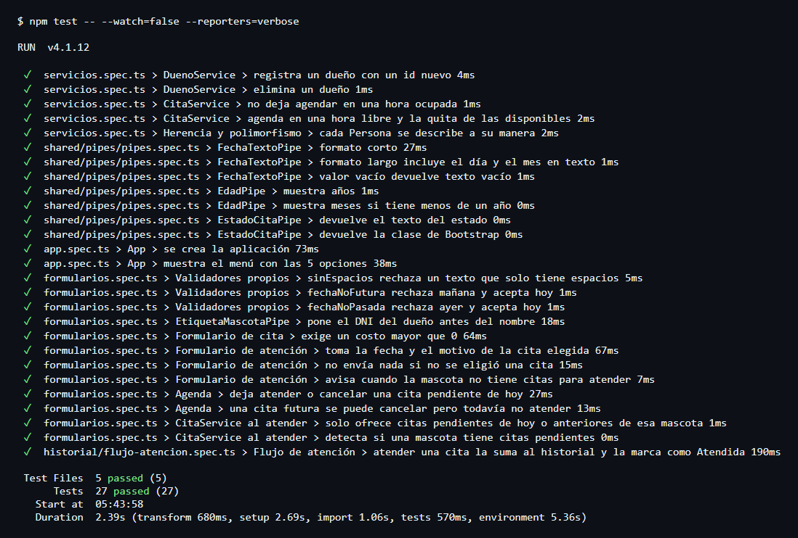
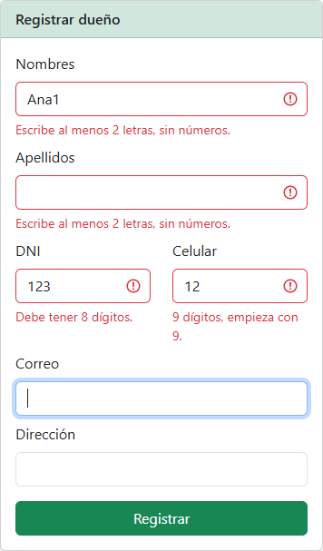
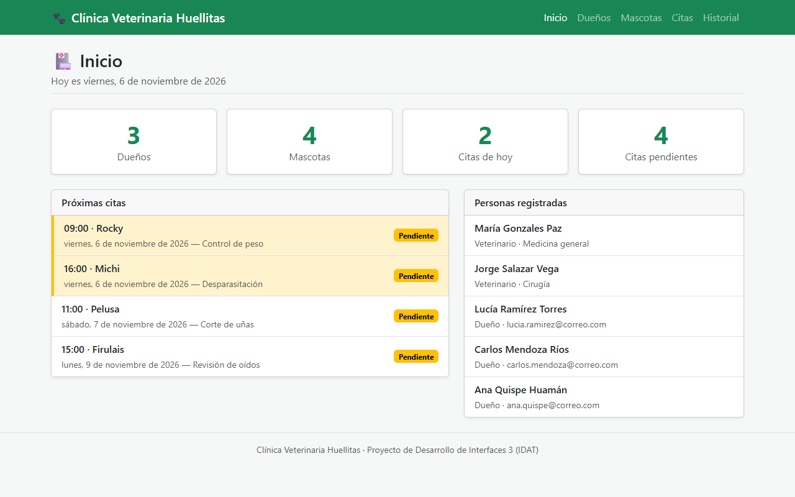
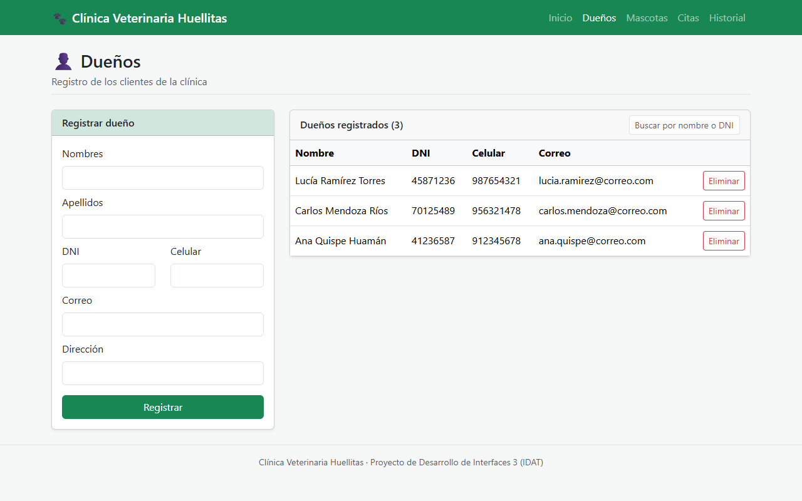
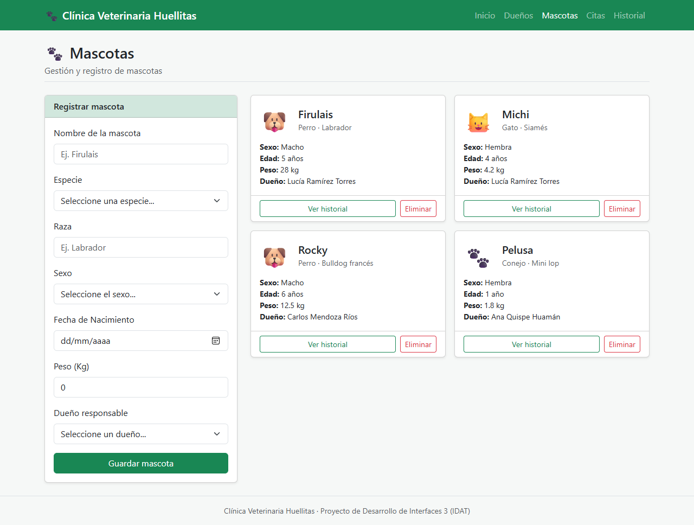
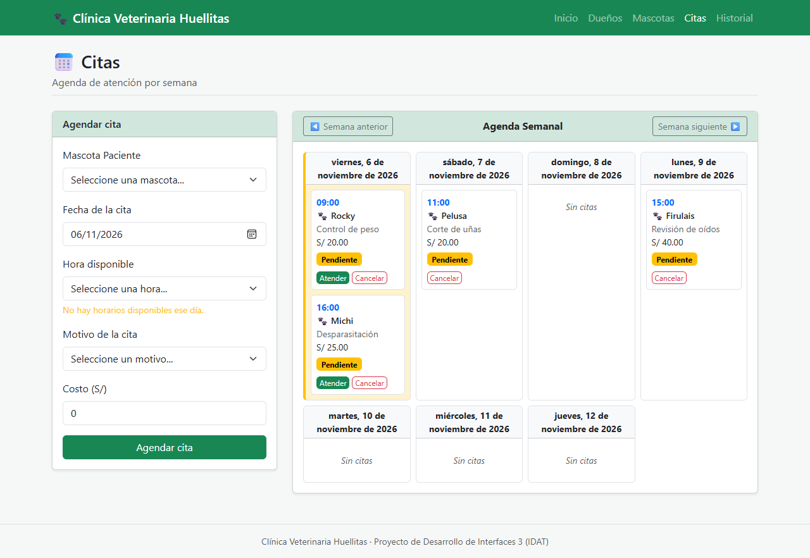
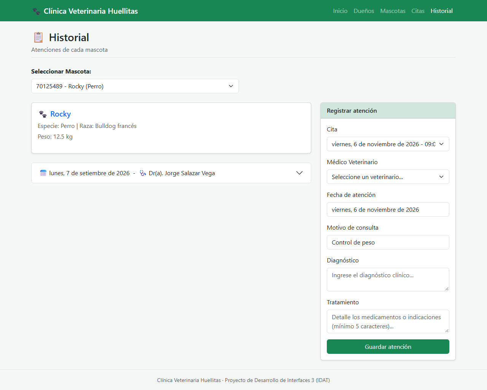
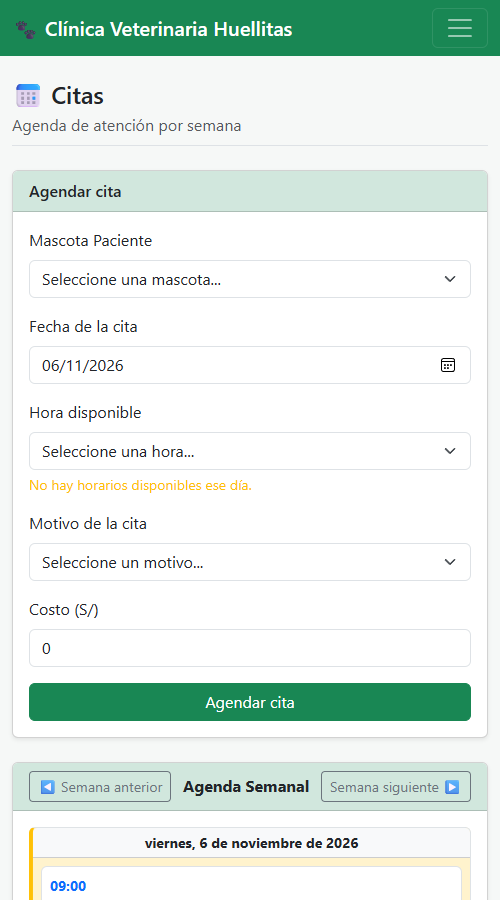

# Clínica Veterinaria Huellitas

Aplicación web en **Angular** y **TypeScript** para digitalizar la atención de una clínica veterinaria:

- Registrar dueños y sus mascotas.
- Agendar citas y verlas en una agenda semanal, solo en horarios libres.
- Consultar el historial de atención de cada mascota.

Proyecto del curso **Desarrollo de Interfaces 3** (IDAT). Los datos se guardan en arreglos dentro de los servicios (no hay base de datos): al recargar la página vuelven los datos de ejemplo.

## Integrantes

| Integrante | Parte del proyecto |
|---|---|
| Wali Jhonatan Oropeza Ávila | Estructura del proyecto, menú, inicio, modelos y servicios, carpeta `shared` (pipes, directiva, componentes, validadores), módulo Dueños, atención ligada a la cita, pruebas, README |
| Rosmery Espinoza Quito | Módulo Mascotas, documento de análisis y diseño (necesidades, problemas, flujos) |
| Abraham Sebastiam Lopez Marmanillo | Módulo Citas (formulario y agenda) y módulo Historial, bocetos de pantallas |

## Tecnologías

| Herramienta | Versión |
|---|---|
| Node.js | 20.19 o superior |
| Angular | 21 |
| TypeScript | 5.9 |
| Bootstrap | 5.3 |
| Vitest (pruebas) | 4 |

## Dependencias

Requisitos del entorno: Node.js 20.19 o superior, npm y un navegador actual. No necesita base de datos ni servidor propio.

| Paquete | Para qué se usa |
|---|---|
| `@angular/core`, `common`, `router`, `platform-browser`, `compiler` | Base de la aplicación, componentes y rutas |
| `@angular/forms` | Formularios reactivos y validaciones |
| `bootstrap` | Estilos y componentes (navbar, cards, modal, acordeón) |
| `rxjs`, `tslib` | Librerías que Angular necesita para funcionar |
| `@angular/cli`, `@angular/build`, `@angular/compiler-cli`, `typescript` | Compilar y ejecutar el proyecto (desarrollo) |
| `vitest`, `jsdom` | Pruebas (desarrollo) |
| `prettier` | Formato del código (desarrollo) |

Las versiones exactas quedan fijadas en `package-lock.json`.

## Instalación

```bash
git clone <enlace-del-repositorio>
cd clinica-veterinaria
npm ci
```

> Si `npm ci` falla con el error `Cannot read properties of null (reading 'edgesOut')`, es un error de npm 10.8. Se soluciona con `npx npm@11 ci`.

## Ejecución

```bash
npm start
```

Abrir <http://localhost:4200>.

## Pruebas

```bash
npm test -- --watch=false
```

Para ver una línea por cada prueba:

```bash
npm test -- --watch=false --reporters=verbose
```

### Qué se prueba

| Archivo | Pruebas | Qué comprueba |
|---|---:|---|
| `src/app/app.spec.ts` | 2 | La aplicación se crea y el menú tiene sus 5 opciones |
| `src/app/servicios.spec.ts` | 5 | Registrar y eliminar, horario ocupado, herencia y polimorfismo de `Persona` |
| `src/app/shared/pipes/pipes.spec.ts` | 7 | Pipes `fechaTexto`, `edad` y `estadoCita` |
| `src/app/formularios.spec.ts` | 12 | Validadores propios, pipe `etiquetaMascota`, formularios de cita y atención, botones de la agenda |
| `src/app/historial/flujo-atencion.spec.ts` | 1 | Flujo completo: al atender una cita, se suma al historial y pasa a Atendida |

### Evidencia

Resultado de la última ejecución: 5 archivos y 27 pruebas aprobadas.



Validaciones en pantalla, con datos incorrectos en el formulario de dueño:



## Estructura del proyecto

```
src/app/
├── shared/                  Lo que usan todos los módulos
│   ├── models/                  Interfaz Describible y clase abstracta Persona
│   ├── services/repositorio-memoria.ts   Clase base genérica (arreglo en memoria)
│   ├── pipes/                   fechaTexto, edad
│   ├── validators/              sinEspacios, fechaNoFutura, fechaNoPasada
│   ├── directives/              appResaltarFecha (resalta lo de hoy)
│   ├── components/              menú y encabezado de página
│   └── utils/fechas.ts          funciones para fechas "AAAA-MM-DD"
├── inicio/                  Resumen del día
├── duenos/                  Módulo Dueños (modelo, servicio, formulario, tabla, página, rutas)
├── mascotas/                Módulo Mascotas (incluye la tarjeta reutilizable)
├── citas/                   Módulo Citas (pipe estadoCita, formulario, agenda)
└── historial/               Módulo Historial (atenciones y veterinarios)
```

Cada módulo tiene su archivo `*.routes.ts` y se carga cuando el usuario entra a esa sección (`loadChildren` en `app.routes.ts`).

## Qué se aplicó de la rúbrica

| Criterio | Dónde está |
|---|---|
| Tipos, interfaces y funciones tipadas | `*.model.ts` (interfaces `Mascota`, `Cita`, `Atencion`; tipos `Sexo`, `EstadoCita`) |
| POO: herencia, abstracción, polimorfismo, encapsulamiento | `Persona` (abstracta) → `Dueno` y `Veterinario`; `RepositorioMemoria<T>` → todos los servicios; `datos` es `protected` |
| Implementación de interfaces | `Persona implements Describible`; los pipes implementan `PipeTransform` |
| Arquitectura modular | Una carpeta por funcionalidad + `shared`, con rutas propias |
| Componentes con `@Input` / `@Output` | `DuenoForm`, `DuenoLista`, `MascotaForm`, `TarjetaMascota`, `CitaForm`, `Agenda`, `AtencionForm`, `EncabezadoPagina` |
| Pipes y directivas personalizados | `fechaTexto`, `edad`, `estadoCita`, `etiquetaMascota`, `appResaltarFecha` |
| Bootstrap | Navbar adaptable, cards, tablas, alertas, modal de confirmación, acordeón del historial, formularios con validación |
| ReactiveForms y validaciones | Formularios de dueño, mascota, cita y atención; validadores propios en `shared/validators` |

## Capturas

**Inicio**



**Dueños**



**Mascotas**



**Citas**



**Historial:** la fecha y el motivo se cargan desde la cita elegida.



**Citas en celular**


